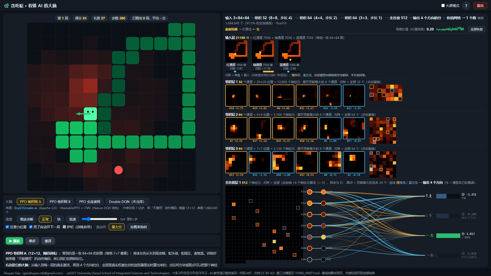
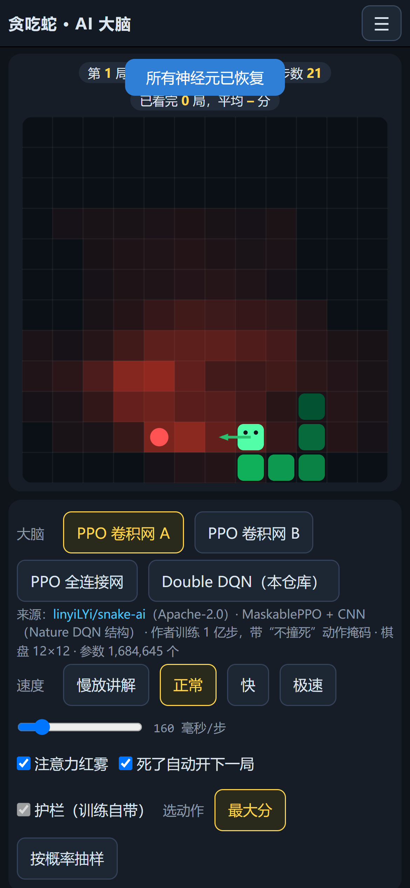
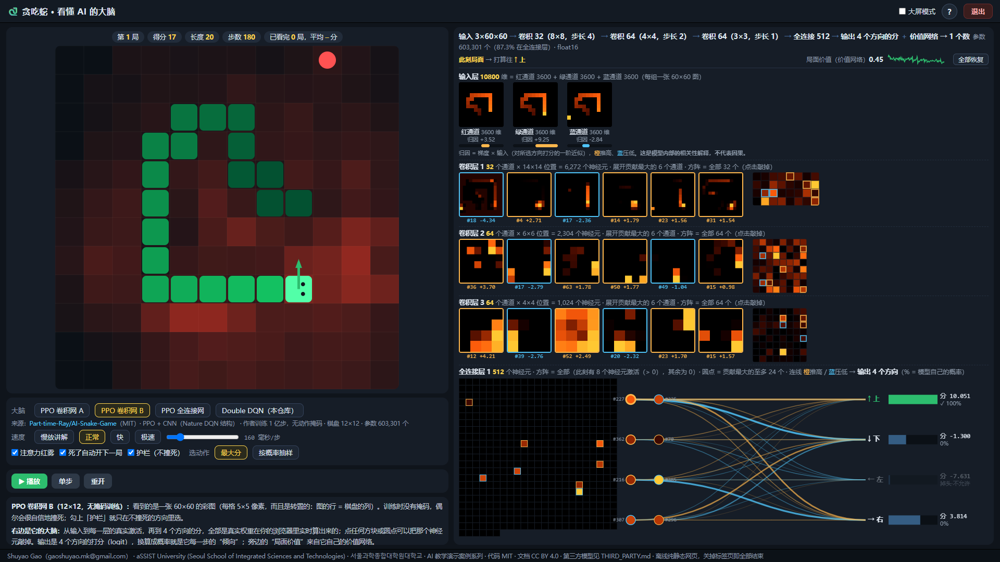
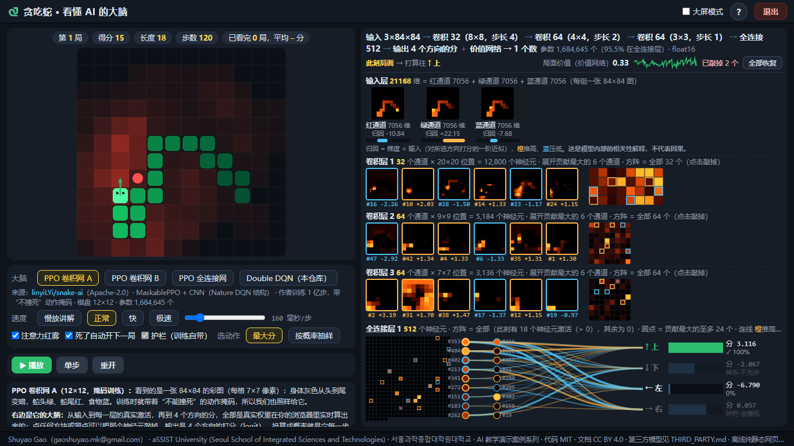

> **AI 教学演示案例 / AI Teaching Demos** 系列

# 贪吃蛇 · 看懂 AI 的大脑

**Shuyao Gao**（gaoshuyao.mk@gmail.com）· aSSIST University (Seoul School of Integrated Sciences and Technologies) · 서울과학종합대학원대학교
代码 MIT · 文档与教学素材 CC BY 4.0 · 第三方模型权重按各自许可证（见 `THIRD_PARTY.md`）

四个训练好的神经网络轮流玩贪吃蛇，你在旁边看它们的“大脑”：**每一层的真实激活、给 4 个方向打的分、它在看哪里**，都是真实权重在你的浏览器里实时算出来的；还能亲手“敲掉”神经元看它变笨。手机、电脑都能直接用，不用安装、不用联网。

| 页面上的名字 | 来自 | 怎么训练的 | 棋盘 | 参数 |
|---|---|---|---|---|
| **PPO 卷积网 A** | [linyiLYi/snake-ai](https://github.com/linyiLYi/snake-ai)（Apache-2.0） | MaskablePPO + 卷积网，作者训练 1 亿步，带“不撞死”动作掩码 | 12×12 | 1,684,645 |
| **PPO 卷积网 B** | [Part-time-Ray/AI-Snake-Game](https://github.com/Part-time-Ray/AI-Snake-Game)（MIT） | PPO + 卷积网，作者训练 1 亿步，无掩码 | 12×12 | 603,301 |
| **PPO 全连接网** | linyiLYi/snake-ai（Apache-2.0） | MaskablePPO + 两层 64 的全连接网 | 12×12 | 27,205 |
| **Double DQN（本仓库）** | 本仓库 `train.py` | 纯 CPU 训练约 15 分钟 | 10×10 | 1,696,580 |

**English summary.** *Snake · Inside the AI's brain* is a browser-only teaching demo. Four trained policies — two 100M-step PPO convolutional networks and an MLP from open-source projects (Apache-2.0 / MIT, see `THIRD_PARTY.md`), plus a small Double DQN trained in this repository — play Snake while a live brain panel shows the real activations of every layer, the most influential channels / neurons, the action scores (logits or Q values), the state value and a gradient saliency overlay. All weights run as float16 in plain JavaScript (no libraries, no network); you can knock out neurons, switch brains, and compare them on the same fixed games. Works on phones and desktops, online or from a downloaded zip. UI and documentation are in Chinese.



## 怎么打开（不用安装，也不用联网）

- **手机**：点在线链接 <https://ShuyaoGao.github.io/snake-dqn-brain/>（竖屏打开）。
- **电脑**：点在线链接 <https://ShuyaoGao.github.io/snake-dqn-brain/>；或在 [Releases](https://github.com/ShuyaoGao/snake-dqn-brain/releases) 下载 `snake-dqn-brain-v1.1.zip`，**解压后**双击 `index.html`；或仓库首页 **Code → Download ZIP**，解压后双击 `play/index.html`。

Windows 用自带的 Edge 打开，Mac 用 Safari 打开。**一定要先解压**，不要在压缩包里直接双击。

## 怎么用

打开就是一个大脑在玩（默认是 PPO 卷积网 A）。左边「大脑」一行的四个按钮（或按键 1 / 2 / 3 / 4）随时切换网络：棋盘大小、输入图、每一层都会跟着换，右边的对照表记下每个大脑看过的局数和平均分。

- **速度**：慢放讲解 / 正常 / 快 / 极速四档，滑块细调；「单步」一步一步看。
- **注意力红雾**：棋盘上的红雾 = 网络做这次决定时最“在意”的格子（|∂ 所选方向的分 / ∂ 输入|，按格子汇总）。
- **护栏（不撞死）**：只在不会立刻撞墙、撞身的方向里选。卷积网 A 和全连接网训练时就带这个掩码（是模型的一部分，不能关）；卷积网 B 训练时没有，这个开关是我们加在模型外面的规则，关掉就是它本来的样子；DQN 默认关。
- **选动作**：「最大分」每步走分最高的方向（确定性）；「按概率抽样」按模型给出的概率抽签（PPO 训练时就是这么走的）。全连接网默认抽样——它总选最大分时会原地绕圈饿死。
- **敲掉神经元**：右边每个小方块、小圆点都是神经元，点一下就把它的输出变成 0，看蛇会不会变笨；「全部恢复」一键复原。

**电脑（键盘 / 鼠标）**：左边是棋盘和选项，右边是大脑面板。

| 按键 | 作用 |
|---|---|
| 空格 | 播放 / 暂停 |
| → 或 . | 单步 |
| R | 重开（回到第 1 局，种子 999） |
| 1 / 2 / 3 / 4 | 换大脑 |
| B | 大屏模式（左右比例 45:55 → 35:65，适合投影） |
| H 或右上角 ? | 再看一次操作说明 |

**手机（竖屏触屏）**：上面是棋盘，往下滑是大脑面板（紧凑画法），点方块、圆点一样能敲掉神经元；「大脑」一行点按钮换网络；☰ 菜单里有操作说明、全部恢复和退出。



右边（手机上是下方）的**大脑面板**全部来自真实权重，在浏览器里实时计算：

- 顶部结构式，例如 `输入 3×84×84 → 卷积 32（8×8，步长 4）→ 卷积 64（4×4，步长 2）→ 卷积 64（3×3，步长 1）→ 全连接 512 → 输出 4 个方向的分 ＋ 价值网络 → 1 个数`，以及参数个数。
- **输入层**：网络“看到”的图。两个卷积网看到的是一张彩图（身体灰色从头到尾变暗、蛇头绿、食物蓝；A 还把蛇尾标红；B 的图是转置的），全连接网看到一张 12×12 的数表，DQN 看到 5 张 10×10 的图。每张下面是归因条（梯度 × 输入）。
- **卷积层**：展开对这一步决策贡献最大的 6 个通道的特征图（手机上 4 个）；右侧方阵是这一层的全部通道。
- **全连接层**：全部神经元的方阵，加上贡献最大的 24 个圆点，连线粗细表示它们对各方向打分的贡献。
- **输出**：4 个方向的分。PPO 大脑给的是 logit，换算成概率就是它每一步的“倾向”；DQN 给的是 Q 值（“往这边走，以后大概还能拿到多少奖励”）。绿色是实际选择；被掩码挡住的方向（掉头、护栏）显示为灰色。
- **局面价值**：PPO 大脑是它自己价值网络的估计，DQN 是合法方向里最大的 Q 值；旁边是这一局的变化曲线。



归因和贡献是模型内部的相关性解释，不代表因果。

## 课堂上怎么用（推荐顺序，约 25 分钟）

1. **先看强的（5 分钟）**：PPO 卷积网 A，正常速度。只讲两件事——它看到的是一张图（输入层三张通道图），它吐出的是 4 个方向的分（输出）。
2. **单步 + 红雾（3 分钟）**：暂停，一步一步走。红雾通常落在蛇头周围、食物方向和可能撞上的身体；再看卷积层展开的几个通道各自“盯着”什么。
3. **换大脑比一比（7 分钟）**：切到 Double DQN（本仓库），同样的面板、同样的种子，它 20 来步就撞死——讨论差在哪：训练量（15 分钟 vs 1 亿步）、输入编码（5 张平面 vs 一张图）、算法（DQN vs PPO）。再切到全连接网：没有卷积层，看它“最大分”时怎么原地绕圈，切到“按概率抽样”才走得出去。
4. **护栏实验（5 分钟）**：切到 PPO 卷积网 B，关掉「护栏」，用“极速”看平均分；再打开护栏看平均分。讨论：护栏是模型学会的吗？（不是，是外面加的规则）训练时的动作掩码和现在加的护栏有什么不同？
5. **敲神经元（5 分钟）**：在卷积网 A 上敲掉全连接层贡献最大的那个神经元，看分怎么变；连续敲掉几个卷积通道，切到“极速”看平均分掉多少，最后「全部恢复」。

讨论题：

1. **同一个局面，两个强大脑的选择一样吗？** 切换大脑后游戏会重开（种子一样），找一个两边都走到过的局面比较它们的输出。分不一样，但都能活下去——“正确答案”有很多个。
2. **输入图为什么要把身体画成渐变灰？** 对比 DQN 的 5 张平面：如果只画身体不分头尾、不给方向，网络能知道蛇往哪边走吗？
3. **“按概率抽样”为什么有时比“最大分”好？** 全连接网最大分时绕圈，是因为它在那几个格子里的最大分总是指回同一条路；抽样引入了随机性。那为什么卷积网 A 最大分就够了？

## 它是怎么做的

### 四个大脑的来源与成绩

成绩都来自 `results/brains.json`（`python -m tools.eval_brains` 重新生成）：固定种子 999，每个大脑跑 30 局，环境是本仓库的 `snake_env.py`（撞墙、撞身即死；连续 2N² 步没吃到判饿死）。页面观看模式的开局顺序和评估一样，不敲神经元、不改设置时前 30 局就是这些局。

| 大脑 | 设置 | 平均吃到 | 单局最多 | 单局最少 | 平均步数 |
|---|---|---|---|---|---|
| PPO 卷积网 A | 最大分 · 模型自带掩码（页面默认） | **59.57** | 84 | 18 | 672 |
| PPO 卷积网 A | 按概率抽样 · 模型自带掩码 | 56.57 | 75 | 38 | 627 |
| PPO 卷积网 B | 最大分 · 护栏开（页面默认） | **95.47** | 121 | 1 | 2794 |
| PPO 卷积网 B | 最大分 · 无护栏（原模型本来的样子） | 78.73 | 118 | 2 | 2160 |
| PPO 卷积网 B | 按概率抽样 · 无护栏 | 77.2 | 112 | 3 | 2057 |
| PPO 全连接网 | 按概率抽样 · 模型自带掩码（页面默认） | **13** | 28 | 2 | 839 |
| PPO 全连接网 | 最大分 · 模型自带掩码 | 3.37 | 18 | 0 | 340 |
| Double DQN（本仓库） | 最大分 · 只禁掉头（页面默认） | **12.8** | 23 | 2 | 116 |

- 12×12 棋盘最多吃 141 个（蛇长 144 通关）；10×10 最多 97 个。
- 卷积网 B 的原作者在 README 里写的是“1 亿步后平均长度 98”（他们的环境和评估方式，不是这里的数字）；卷积网 A 的原作者没有公布数字。
- 三个 PPO 大脑**没有重新训练**，只把原作者公开的权重转成 float16（`tools/export_sb3.py`，不需要 PyTorch）放进 `play/model/`；它们看到的图按原项目的代码逐行复现（`play/js/snake_env.js` 与 `brains.py`，测试锁定逐位一致）。来源、提交号、许可证见 `THIRD_PARTY.md`。
- DQN 的训练（`train.py`）：Double DQN + 经验回放 + 目标网络 + ε 线性衰减，纯 CPU 约 15 分钟（步数未记录）；它自己的评估在 `results/result.json`：30 局平均吃到 12.8。

### 网络结构

```
PPO 卷积网 A：输入 3×84×84 ─► 卷积 8×8/4 ·32 ─► 卷积 4×4/2 ·64 ─► 卷积 3×3/1 ·64 ─► 全连接 512 ─┬► 4 个方向的 logit
PPO 卷积网 B：输入 3×60×60 ─► （同上结构，全连接输入 1024）                                  └► 价值 V(s)
PPO 全连接网：输入 12×12 ─► 全连接 64 ─► 全连接 64 ─► 4 个 logit（价值网络另一条同样的支路）
Double DQN：  输入 5×10×10 ─► 卷积 3×3·32 ─► 卷积 3×3·64 ─► 卷积 3×3·64 ─► 全连接 256 ─► Q(上, 下, 左, 右)
```

### 浏览器端（`play/js/`）

- `snake_env.js` 逐行移植 `snake_env.py`，并实现四种观测编码和两种动作掩码（和 `brains.py` 一致）；
- `pyrandom.js` 复现了 Python 的随机数（MT19937），同一种子的食物位置、抽样结果和 Python 完全一样；
- `brain_net.js` 是通用的网络：按模型文件里的 `spec`（卷积 / 全连接层、策略头、价值头）做前向，并手写反向传播算每一层的贡献和输入显著性；
- 模型在 `play/model/*.js`（float16、base64），用普通 `<script>` 加载，所以双击 `index.html`（`file://`）就能运行。

### 测试（`tests/`）

- JS 随机数 = CPython；JS 环境逐步 = Python 环境；
- 四个大脑的观测编码、动作掩码 = NumPy（逐位相等）；
- 四个大脑的前向、价值、梯度、贡献、“敲掉”后的结果 = NumPy 参考实现（`brains.py`，误差 < 1e-4）；参考实现的梯度再用有限差分核对；
- JS 对局（最大分和抽样）= NumPy = `results/brains.json`；
- 页面不依赖网络、体积不超标、署名已填；
- 浏览器验收（可选，需本机 Edge）：电脑 1920×1080、1366×768 自检（四个大脑各跑一段、敲掉 / 恢复、护栏 / 抽样开关、大屏模式、帮助、退出），手机 390×844、414×896、360×780、768×1024 触屏模拟（面板在棋盘下方且不超宽、敲掉 / 恢复、切换四个大脑、无 JS 报错、无横向溢出）。



## 想自己训练或修改

需要 Python 3.10+ 和 NumPy；跑测试还需要 Node.js；训练 DQN 需要 PyTorch。

```bash
pip install -r requirements.txt

# 重新评估四个大脑 -> results/brains.json 与 play/js/results.js（纯 NumPy，几分钟）
python -m tools.eval_brains            # 加 --js 会同时在 Node 里跑浏览器代码并要求逐局一致

# 换一个 Stable-Baselines3 的 PPO 模型进来（不需要 PyTorch）
python -m tools.export_sb3 ray   path/to/model.zip      # 或 linyi / linyi_mlp，见文件头
# 然后在 play/js/config.js 的 brains 里登记，重新评估、重新打包

# 训练自己的 DQN（纯 CPU；会覆盖 checkpoints/dqn_snake_best.pt，先备份）
python train.py --grid 10 --max-minutes 15
python -m tools.eval_model && python -m tools.export_model

# 打发布包 -> play/ 与 release/*.zip；测试；浏览器验收（需本机 Edge；手机尺寸需 pip install playwright）
python -m tools.build --release
python -m pytest
python -m tools.browser_check --mobile --shots docs/img
```

署名、系列名、仓库名都集中在 `credits.json`；改完运行 `python -m tools.fill_credits --release`，会重新生成 README、CITATION.cff、LICENSE、根目录 index.html、页面页脚和发布 zip。

## 目录结构

```
index.html            根目录入口：自动跳到 play/index.html（GitHub Pages 和解压后双击都用它）
.nojekyll             让 GitHub Pages 原样发布，不经 Jekyll
play/                 网页（双击 index.html）
  index.html
  css/app.css         样式（含手机竖屏布局）
  js/config.js        四个大脑的登记表、名称、预设档位、颜色（集中在这一个文件）
  js/pyrandom.js      与 Python 一致的随机数
  js/snake_env.js     贪吃蛇环境 + 四种观测编码 + 动作掩码（移植自 snake_env.py / brains.py）
  js/brain_net.js     通用网络：前向 / 反向计算
  js/app.js           页面逻辑（观看、换大脑、大脑面板、帮助、退出、手机布局）
  js/credits.js       署名（由 credits.json 生成）
  js/results.js       评估数字（由 results/brains.json 生成）
  model/              四个模型（float16）：ppo_cnn_linyi、ppo_cnn_ray、ppo_mlp_linyi、snake_cnn（DQN）
snake_env.py          环境
brains.py             四个大脑的 NumPy 参考实现（观测、掩码、前向、反向）
model.py / train.py   DQN 网络与训练
checkpoints/dqn_snake_best.pt   训练好的 DQN（float32）
results/brains.json   四个大脑的评估结果（README 和页面里的数字都来自这里）
results/result.json   DQN 自己的评估结果
LICENSES/             第三方模型的许可证原文
tools/                导出（export_sb3 / export_model）、评估（eval_brains / eval_model）、构建、浏览器验收、署名填充
tests/                一致性测试与页面检查
docs/img/             截图
```

## 常见问题

- **关掉页面后还有程序在跑吗？** 没有。这是纯静态网页，关掉标签页就全部结束，不留任何后台进程。右上角「退出」（手机在 ☰ 菜单里）会先停止所有计算，再尝试关闭标签页；浏览器不允许关闭时，会显示“已停止运行”。
- **双击后是空白或提示模型没加载？** 先把整个 zip 解压，再双击解压出来的 `index.html`（或 `play/index.html`）；`play` 文件夹里的文件要放在一起。第一次打开要读取约 11 MB 的模型文件，旧手机上可能要等几秒。
- **为什么卷积网 B 有时很自信地撞死？** 它训练时没有动作掩码，评估时又是按概率抽样走的；换成“最大分”后，少数局面里分最高的方向正好是身体。「护栏」只是把这些方向挡掉，不改模型。
- **为什么全连接网默认“按概率抽样”？** 它总选最大分时会在几个格子里来回绕，直到饿死；抽样是 PPO 训练时的走法，也是它原作者测试时的走法。
- **能换成自己的模型吗？** 能：Stable-Baselines3 的 PPO / MaskablePPO 模型用 `tools/export_sb3.py` 导出，在 `config.js` 登记即可；其他框架需要自己写导出（格式见 `brain_net.js` 文件头）。

## 测试情况与已知限制

- Microsoft Edge（Windows）：电脑 1920×1080 和 1366×768 两种窗口大小下跑过页面自检（四个大脑、敲掉 / 恢复、护栏 / 抽样开关、大屏模式、帮助、退出），没有 JS 报错；手机 390×844、414×896、360×780（DPR 3）和 768×1024（DPR 2）用 DevTools 协议模拟触屏跑过场景检查。
- Chrome 与 Edge 内核相同，但没有单独测；Firefox 未测。
- **Safari / iPhone 需要在真实的 Mac 和 iPhone 上确认**，目前还没有实测；安卓真机也未实测，只有模拟。
- 卷积网 A 每一步要在浏览器里算 84×84 的卷积；“极速”档在旧手机上会慢一些（面板每 4 步刷新一次）。

## 许可证与引用

代码 MIT（见 `LICENSE`），文档与教学素材（README、截图、页面文字）CC BY 4.0（见 `LICENSE-docs`），使用请注明出处。三个 PPO 模型的权重来自原作者，按 Apache-2.0 / MIT 随本仓库分发，许可证原文在 `LICENSES/`，详见 `THIRD_PARTY.md`。引用信息见 `CITATION.cff`（GitHub 页面右侧的 “Cite this repository”）。联系作者：gaoshuyao.mk@gmail.com。

## AI 辅助开发声明

代码由 Claude Code 辅助编写，经作者审阅。
